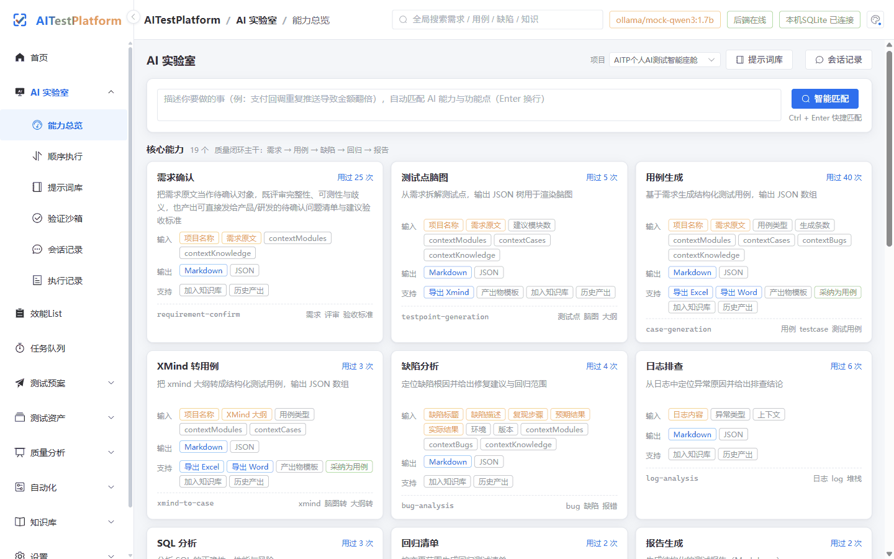
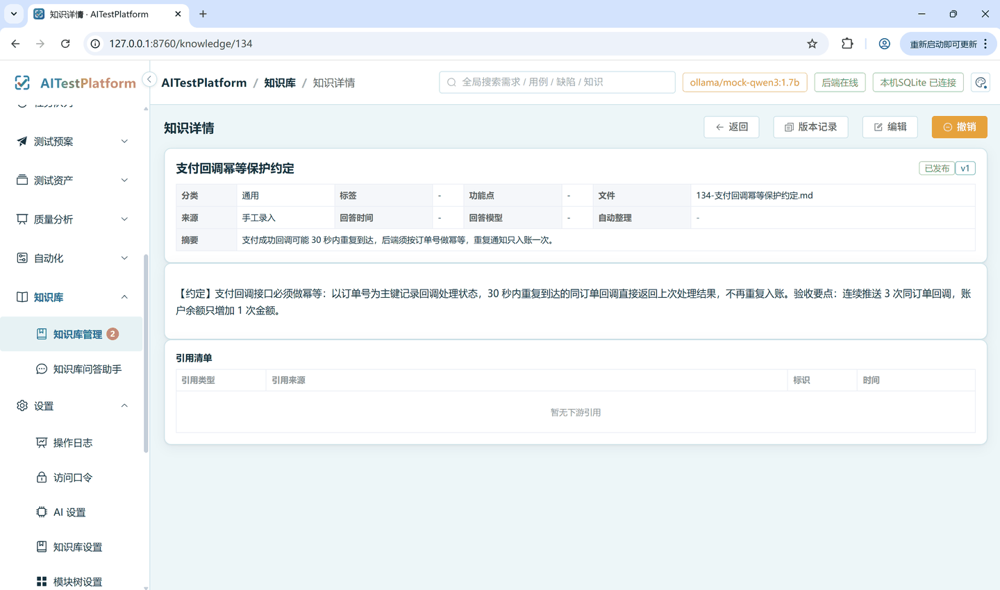
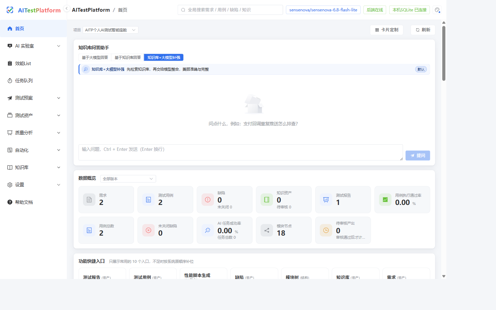
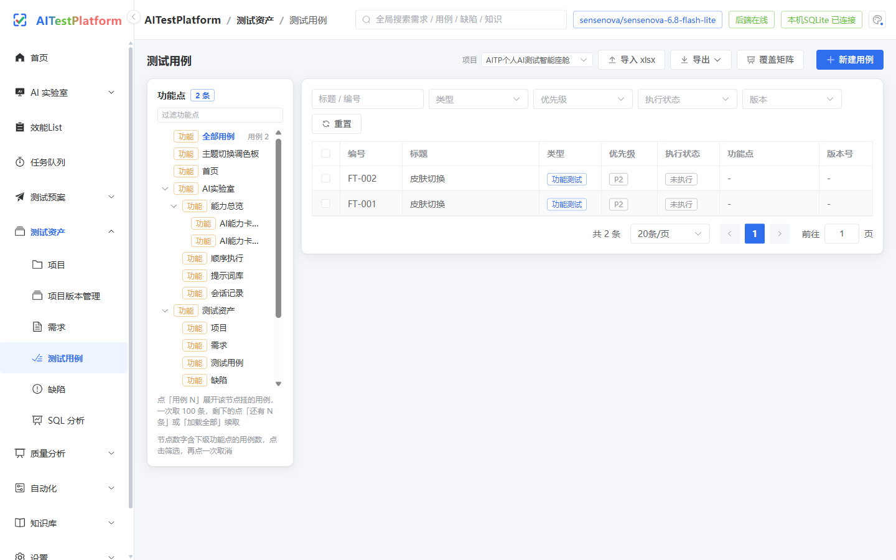

# AITestPlatform (AITP)

[English](README.en.md) | 简体中文

个人版的AI 测试工作台 —— **单用户、本地优先、离线可用**、**提示词工程，大模型调用数据脱敏**的质量管控工具。

把 AI 实验室、测试用例、缺陷、日志分析、SQL 分析、回归、报告、知识库、任务清单、工作台配置利用AI的LLM辅助测试工作，收进同一条闭环：
**需求 → 测试点 → 用例 → 执行 → 缺陷 → 回归 → 报告 → 知识沉淀**，中间随时把待办推进度挂在清单里。

- 数据全部保存在本机 SQLite（`data/aitp.db`），默认仅本机可访问，不对局域网/公网暴露。
- AI 能力直接读取本地环境变量中的 AI 配置信息获取，同时支持工作台内配置与本地大模型（Ollama）。
- 没有云端模型、模型不可用或断网时，自动降级到本地规则，不阻塞主流程。

## 运行演示

下面两个演示均跑在**本地 Ollama mock 模型**上（`docs/screenshots/` 下是真实运行截图，非设计稿）：

**AI 能力卡片 · 用例生成** —— 选能力卡 → 填需求原文 → 本地模型产出结构化用例（含正向/异常/边界/接口多类），可导出 Excel/Word 或一键采纳为用例：



**知识库问答助手** —— 手工录入知识条目进待审池 → 提问 → 助手先检索知识库、再由模型整合，回答带 `[K1]` 等引用来源标注：



> 演示中默认档案为本地 mock 模型，不消耗任何云端额度；换成云端 Key 后同一套链路即可调用真实大模型。

**首页工作台** —— 数据概览、知识库问答入口、卡片自定义：



**测试用例** —— 按功能点树浏览、筛选、导入导出、覆盖矩阵：



---

## 快速开始

**Windows**

```bat
start.bat
```

**macOS / Linux**

```bash
./start.sh
```

首次运行会创建 `.venv`、安装依赖、构建前端，随后在 <http://127.0.0.1:8760> 启动。

停止服务：

```bat
stop.bat          :: Windows
```

```bash
./stop.sh         # macOS / Linux
```

### 启动脚本参数

| 参数 | 说明 |
|---|---|
| `--build` | 强制重新构建前端 |
| `--reinstall` | 重建虚拟环境并重装依赖 |
| `--no-browser` | 启动时不自动打开浏览器 |

脚本会先检查端口：若 AITP 已在运行则直接打开页面，不会重复启动；若端口被其它程序占用则明确报错退出。

### 环境要求

- Python 3.11+（3.11 / 3.12 为全门禁验证版本；3.13 可用，numpy 会自动换到 2.x）
- SQLite 3.34+ 且带 FTS5 trigram（启动时自检；系统自带 Python 过旧会直接提示换解释器）
- Node.js 20+（仅首次构建前端需要）

---

## 功能地图

前端 46 条路由 / 47 个页面组件，后端 34 个蓝图 / 337 个接口统一挂在 `/api/v1` 下。

### 首启引导与示例项目

- 空数据库首次启动，首页自动弹出四步引导：配置 AI 模型 → 载入示例项目 → 跑一次 AI 生成 → 看报告与追溯；可跳过，完成或跳过后不再自动弹出，存量库升级默认不打扰。
- 「载入示例项目」以追加方式注入 `DEMO-EC` 示例（需求 / 用例 / 缺陷 / 知识 / 报告 + 可执行接口断言脚本 `AUTO-API-001`），只重建示例自身、不动既有数据，可重复点击重建；项目列表空态也能一键载入。
- 帮助页（`/help`）右上角「重新打开首启引导」可随时重看；状态接口 `GET/POST /api/v1/onboarding`、注入接口 `POST /api/v1/onboarding/demo`。

### 首页

- 概览指标：项目数、用例数、缺陷数、待审知识数
- 快捷入口：常用入口 Top 10，按真实点击次数排序（含 AI 能力与模块树、资产、系统设置入口），没点过的按原顺序补位
- 近期报告与缺陷动态
- 卡片可定制：见 **设置 → 首页卡片定制**（`/settings/home-cards`）

### 外观与导航

- **10 套主题**：白、黑、蓝、红、粉、橙、科技、海洋、植物、工业。右上调色盘一次点选即全站生效。
- **导航分组**：侧栏按用途分成 AI 实验室 / 测试预案 / 测试资产 / **质量分析** / 自动化 / 知识库 / 设置 七个组。
- **筛选即查询**：列表页筛选项一改就自动出结果，不再需要点「查询」；筛选与分页仍写进地址栏，链接可分享。

### 任务清单

页面：**任务清单**（`/todos`）

- 顶部速览：未完成 / 今天到期 / 逾期 / 已完成 / 完成率
- 左侧视图：全部任务、今天到期、本周到期、已逾期、置顶、已完成
- 中间清单：快速录入、筛选、批量操作与导出
- 右侧详情：状态、优先级、到期日、分类、标签、所属项目、进度与说明，可挂子任务
- 子任务完成度自动回推父任务

### AI 实验室

19 项能力，基于知识库的问答走「知识库 → 问答助手」的对话面板：

| 能力 | 标识 |
|---|---|
| 需求确认 | `requirement_confirm` |
| 测试点脑图 | `testpoint_generation` |
| 用例生成 | `case_generation` |
| XMind 转用例 | `xmind_to_case` |
| 缺陷分析 | `bug_analysis` |
| 日志排查 | `log_analysis` |
| SQL 分析 | `sql_analysis` |
| 回归清单 | `regression_generation` |
| 报告生成 | `report_generation` |
| 进度看板 | `project_progress_board` |
| 接口测试设计 | `api_test_design` |
| 测试计划 | `test_plan` |
| 用例评审 | `case_review` |
| 缺陷归类 | `bug_classification` |
| 风险评估 | `risk_assessment` |
| 自动化脚本生成 | `automation_script` |
| 性能脚本生成 | `performance_script` |
| 测试数据生成 | `test_data_generation` |
| 提示词优化 | `prompt_optimize` |

- **能力卡片由提示词库驱动**
- **智能路由**：输入一句话，自动匹配最合适的能力
- **执行前预检**：跑之前先体检，列出缺项、完整度、主/辅助任务与执行顺序
- **上下文装配**：按项目与功能点召回模块、既有用例、缺陷与知识注入提示词，档位「精简 / 标准 / 完整」，默认标准档（GAP-27）
- **输出结构校验**：产出按 JSON Schema 校验，字段缺失或类型错位当场拦截，并给出可重试的中文说明（GAP-28）
- **生成去重**：与库内已有用例逐条比对，判定模式「标记疑似重复 / 按基线增量补充」可配，疑似项默认不勾选（GAP-29）
- **成本核算**：按供应商档案单价折算每次调用的 token 与金额，日/月预算与单次 token 上限只做软提示、不拦截（GAP-30）
- **会话记录**：每次运行留痕，可回看输入、输出、模型、用量与降级情况
- **流式输出**：发起后立即返回任务号，前端按 `framesUrl` 增量轮询取帧（长连接不再占用同步 worker），首选模型失败时先弹降级提示再切模型

### 测试资产

| 模块 | 能力 |
|---|---|
| 项目 | 项目增删改查、当前项目切换、状态管理 |
| 需求 | 需求维护、直挂功能点（模块/子模块/功能点三级）、批量删除、导出 |
| 测试用例 | 用例 CRUD、状态流转、xlsx 导入导出、批量执行 |
| 缺陷 | 缺陷 CRUD、状态机流转、关联用例、日志附件、原始执行证据下钻 |
| 断言库 | 可复用断言规则按项目/功能点共享，接口用例以 `lib:编号` 引用，支持 JSON Schema 断言与失败差异对比 |
| 知识库 | 待审池 → 正式库、版本、审核、引用保护、全文检索 |
| 测试报告 | 报告生成/采纳、ECharts 图表、指标趋势、导出 |
| 执行与证据 | 接口 / 自动化 / 手工 / 回归四条执行路径统一留一份证据快照，轮次、缺陷、报告三处可下钻到原始请求响应与日志 |
| 回归清单 | 清单 CRUD、AI 生成回归条目、自动条目由服务端真跑并留证据、手工条目回写强制附证据 |

### 工作台配置

| 页面 | 内容 |
|---|---|
| AI 配置 | 供应商档案 CRUD、API Key 入密钥库、优先级排序、真实自检、模型列表、档案单价与调用成本、上下文装配档位与去重模式、预算软阈值 |
| 知识库设置 | 存放目录、文件模式、启动重建索引 |
| 模块树管理 | 三级结构维护与能力绑定 |
| 系统配置 | 全量配置项读写 |
| 测试环境配置 | 多套命名环境；每套可挂多台应用服务器并逐台探测、逐台画资源曲线；数据库类型覆盖 MySQL / PostgreSQL / SQL Server / Oracle / SQLite、国产库（达梦、人大金仓、瀚高、openGauss、GaussDB、OceanBase、TiDB、GBase、神通 OSCAR、ClickHouse）与非关系库（MongoDB、Redis、Elasticsearch、Cassandra、InfluxDB）；口令入系统密钥库 |
| 数据备份 | 库快照备份、整包备份、恢复 |
| CI 与通知 | CI 令牌、Webhook 渠道、事件订阅、测试发送 |
| 首页卡片定制 | 首页非固定卡片的显隐与排序 |

---

## AI 接入方式

三层优先级：**工作台配置（数据库） > 环境变量 > 内置默认**

1. **环境变量**（开箱即用）
   - 通用：`AITP_AI_PROVIDER` / `AITP_AI_BASE_URL` / `AITP_AI_API_KEY` / `AITP_AI_MODEL`
   - 分厂商：`OPENAI_API_KEY` / `DASHSCOPE_API_KEY` / `DEEPSEEK_API_KEY` / `OLLAMA_HOST` …
2. **工作台配置**：AI 配置页新增供应商档案，设置优先级
3. **本地大模型**：Ollama（`ollama_native` 协议）

### 优先级与自动降级

- 本地规则即时返回；AI 调用受模型延迟与超时约束，默认 **60 秒**
- 本地模型与云端模型**混排排序**，按优先级从高到低尝试
- 首选模型不可用时，自动降级到下一个候选，前端只弹 **3 秒** toast 提示
- 全部候选都不可用时降级到**本地规则**
- **自检是真实调用**：返回 ✓/✗、延迟、回复片段、token 用量

---

## 数据与知识治理

- 正式知识条目以 **Markdown 落盘**（`knowledge/`），SQLite 只存索引与元数据
- **待审池**：AI 产出先进待审池，人工审核通过才成为正式条目
- **问答助手三种模式**：
  - `llm`：只用模型自身知识作答（外发）
  - `kb`：纯本地检索并直接摘出原文（不外发）
  - `hybrid`（默认）：先检索知识库，把命中正文带 `[K1]…` 标记喂给模型整合（外发）

---

## 性能与可靠性

- **列表不整表吐数**：列表接口走服务端分页（`pageNum` / `pageSize`，单页上限 100），用例树按 `afterId` 游标逐批续取；前端表格在行数超过阈值时启用虚拟窗口，只渲染视口内的行
- **长任务出请求线程**：批量验证 run-all、大文件导出、AI 流式执行都改为后台任务，接口只回任务号，进度与产物按任务查
- **写库加固**：进程内写串行化 + `SQLITE_BUSY` 有界重试，自拟编号的取号与插入在同一事务内完成，避免并发创建撞唯一键
- **可观测性**：每个请求带 `traceId`，贯穿响应头与结构化日志；日志只记异常与慢请求；`/api/v1/health` 返回数据库延迟、写队列与 AI 配置的真实状态
- **异常不静默**：捕获到的异常要么记一行带 `traceId` 的日志继续，要么转成包封错误码，不留裸 `pass`；前端接口失败有可见提示与重试入口，不白屏

---

## 安全边界

- **仅本机**：默认绑定 `127.0.0.1`
- **同源防护**：写接口必须来自本机页面
- **本地访问口令（可选）**：在「设置 → 访问口令」启用，12 小时过期
- **密钥存储**：API Key 存于操作系统密钥库（Windows DPAPI / macOS 钥匙串 / Linux Fernet）
- **AI 外发脱敏**：云端调用默认自动替换手机号、身份证、邮箱、银行卡号、API Key 等
- **AI 行为安全**：证据不足时明确提示而非编造；不编造知识标题或缺陷编号；AI 不批准上线；P0/P1 与 Prompt 测试结果必须人工复核

---

## 质量门禁

一条命令跑全部确定性门禁（runner 自动发现 `backend/scripts/check_*.py` 加 `smoke_api.py`，
按字典序逐个执行，末尾输出汇总表，任何失败退出码非 0）：

```bash
python backend/scripts/run_all_checks.py                                  # 全量，单脚本默认超时 300s
python backend/scripts/run_all_checks.py --list                           # 只列会跑哪些脚本
python backend/scripts/run_all_checks.py --only check_db,check_fts        # 子串匹配只跑部分
python backend/scripts/run_all_checks.py --skip-name check_walkthrough --timeout 600
python backend/scripts/run_all_checks.py --json logs/gates.json           # 写 JSON 报告，供 CI 归档
cd frontend && npm run build                                              # 前端类型 + 构建（vue-tsc --noEmit && vite build）
```

- runner 先探测 `http://127.0.0.1:8760/api/v1/health`（可用 `--base-url` 或 `AITP_BASE_URL` 覆盖）；
  探测不到时明确警告，并把需要服务的脚本（`check_isolation_matrix`）记为 FAIL 且提示
  「需先启动本地服务」（`python backend/run.py`）。runner 不会自动启动服务，也不会假装通过。
- `--isolated`：不必先手工启动服务——runner 用 SQLite 备份 API 把正式库取成一份一致性快照，
  在空闲端口起一台一次性临时服务（数据库与日志都写在临时目录，正式库只在取快照时以只读方式访问），
  把 `AITP_BASE_URL` 与库/日志路径注入每个子进程；runner 退出时按进程树结束服务并删除临时目录。
  密钥与提示词仍指向正式路径，否则快照里的加密列解不开；与 `--base-url` 互斥，CI 不需要它（干净 runner 上没有正式库可快照）。
  带它的理由是实测出来的：不加时 `check_isolation_matrix` 这类打 HTTP 的门禁会在正式库留下软删行（完整套件
  BEFORE/AFTER 实测 +2/+7/+4/+6 行，全部 `is_deleted=1`），加上同一只门禁 `PASS=191 FAIL=0` 而正式库 delta 为 0。
- `check_ai_live` 被 runner 永久排除：它打真实商汤模型接口、烧额度且非确定性，需要时单独手工跑。
- 新增门禁脚本只要放进 `backend/scripts` 且命名 `check_*.py`，runner 自动纳入，无需改 runner。

门禁清单（45 项 = 44 个 `check_*.py` + `smoke_api.py`，与 `backend/scripts` 下真实脚本一一对应；其中 `check_ai_live` 不进 runner，实际执行 44 项）：

| 脚本 | 含义 | 失败怎么查 |
| --- | --- | --- |
| `check_ai_live.py` | 真实大模型全路径测试（**不进 runner**，打商汤接口烧额度、非确定性） | 需要时手工单跑，见脚本头部环境变量说明 |
| `check_ai_masking.py` | AI 外发脱敏：手机号/身份证/邮箱/银行卡/API Key 自动替换 | 看 `backend/aitp/ai/masking` 规则与档案配置 |
| `check_ai_cost.py` | AI 成本核算：档案单价与微元折算、日/月预算与单次 token 软阈值、超预算只提示不拦截（GAP-30） | 看 `backend/aitp/ai/cost.py` 与 `sys_ai_profile` 的单价字段 |
| `check_attachments.py` | 附件能力：文档导入 + 图片去水印 | 看附件接口、Pillow 依赖与临时 mock 服务日志 |
| `check_automation.py` | 自动化脚本资产与执行引擎 | 看自动化执行记录与引擎日志（`data/aitp.log`） |
| `check_automation_writeback.py` | 自动化结果回写用例/轮次（GAP-07） | 核对回写服务与轮次状态机 |
| `check_backup_schedule.py` | 定时备份与保留策略（GAP-13） | 看备份服务与 `data/` 目录保留逻辑 |
| `check_ci_boundary.py` | CI Token 访问边界：路由白名单、项目范围、有效期、吊销、审计区分（GAP-24） | 看 CI 令牌鉴权中间件与审计来源标记 |
| `check_ci_notifications.py` | CI 触发与 Webhook 通知（GAP-10），自带本地 HTTP 接收器 | 看令牌哈希、通知渠道生效范围与发送记录 |
| `check_context_assembler.py` | 上下文装配：三档限量、按项目/功能点召回模块/用例/缺陷/知识、预览与实装同口径（GAP-27） | 看 `backend/aitp/services/context_assembler.py` 的档位与召回 |
| `check_db.py` | 数据层：PRAGMA、外键约束、种子量、软删、并发写 | 看 `backend/aitp/db` 迁移与连接配置 |
| `check_db_concurrency.py` | 并发写与取号竞态：16 并发创建不撞唯一键、报成功数等于落库数、写锁统计（GAP-26） | 看 `backend/aitp/db/write_guard.py` 与各仓储取号 |
| `check_dedup.py` | 生成去重判定口径：归一化、阈值分档、mark/increment 行为、payload 下标对齐（GAP-29） | 看 `backend/aitp/services/dedup_service.py` |
| `check_env_config.py` | 测试环境配置：CRUD、多台应用服务器、国产/非关系库类型与默认端口、口令加密掩码、健康探测、默认环境唯一 | 看环境配置接口与密钥库落盘 |
| `check_error_boundary.py` | 异常治理与前端兜底：不吞异常、错误带 traceId、长执行出请求线程、空态与重试（GAP-26） | 看 `except Exception` 处置与 `validation_jobs` |
| `check_execution_evidence.py` | 统一执行证据协议：四条执行路径的必填字段矩阵、快照与缺失降级（GAP-32） | 看 `execution_protocol.py` 与 `biz_execution_evidence` |
| `check_export_caps.py` | 导出能力宣称与实现一致：Excel/Word 白名单同源、不支持时给中文降级（GAP-37） | 看 `capability_codes` 白名单与帮助页口径 |
| `check_fts.py` | FTS5 混合检索：中文短词兜底、注入防护、软删过滤、索引同步 | 看检索服务与索引重建逻辑 |
| `check_functional_matrix.py` | 功能矩阵：多项目 × 边界值 × 全路径（临时库自跑） | 按失败项名定位对应模块接口 |
| `check_global_search.py` | 全局搜索能力边界 | 看全局搜索与各模块索引 |
| `check_home_cards.py` | 首页卡片定制：默认布局、脏配置清洗、显隐排序闭环 | 看首页配置读写与清洗逻辑 |
| `check_interface_runner.py` | 接口用例执行引擎：请求组装、断言、超时、同源限制、批量队列 | 看执行引擎与轮次回写 |
| `check_isolation_matrix.py` | 多项目 × 多版本数据隔离审计（HTTP 版，可长跑） | 需先启动本地服务；带 `AITP_ACCESS_TOKEN` 重跑单脚本 |
| `check_kb_ask.py` | 知识库问答检索兜底：自然语言问句能召回正式条目 | 看知识库检索与落盘目录 `knowledge/` |
| `check_knowledge_governance.py` | P8 知识治理：待审转正、版本化、引用保护、重建索引 | 看治理服务与 Markdown 落盘 |
| `check_lab.py` | P6 AI 实验室 | 看实验室能力清单与临时 mock 服务输出 |
| `check_observability.py` | 可观测性：traceId 贯穿日志与响应头、只记异常/慢请求（GAP-23） | 看 `backend/aitp/observability` 与日志格式 |
| `check_onboarding.py` | 首启引导状态（GAP-18） | 看迁移 045 与 onboarding API |
| `check_output_schema.py` | 输出结构校验：四个能力的 JSON Schema、字段缺失与类型错位的拦截、重试口径（GAP-28） | 看 `backend/aitp/ai/output_schema.py` 与能力映射 |
| `check_pagination.py` | 列表分页与游标续取：接口不再整表吐数、`total` 与列表条数一致、用例树按 `afterId` 翻页（GAP-25） | 看 `common/pagination.py` 与各列表接口 |
| `check_portability.py` | 跨平台交付：启动自检、PDF 中文字体、密钥库回落、脚本可移植性 | 按打印的平台相关检查项定位（不写正式库） |
| `check_prompt_regression.py` | 提示词效果回归集：离线 mock 跑批 + 六指标基线（通过率/保留率/完整度/重复率/问题数/提示词体积），改动可对比（GAP-31） | 看 `backend/prompts/regression/` 样例与基线文件 |
| `check_prompts.py` | 提示词库：模板可解析、变量齐全、渲染无残留、能力对齐 | 看 `backend/prompts` YAML 与能力映射表 |
| `check_report_evidence.py` | 报告失败样本与证据下钻：样本条数与真实失败一致、三种导出都带上所选样本、无快照给中文降级、证据只在用例级（手工执行）时报告/下钻/缺陷三处口径一致（GAP-35） | 看 `api/reports.py` 的 failure-samples 与 `execution_protocol.latest_evidence_for_run_case` |
| `check_report_trends.py` | 报告趋势与版本对比（GAP-12） | 看报告导出与趋势聚合 |
| `check_routing.py` | 智能路由回归：18 张能力卡片各至少一条代表性输入必须路由正确 | 看路由规则与能力卡片配置 |
| `check_secret_residue.py` | GAP-22 密钥入库收口：引用式存储、残留检测、迁移/回滚与双读 | 看密钥引用表与残留扫描逻辑（全在临时库，不碰正式库） |
| `check_stream_polling.py` | 流式短轮询契约两端对齐：发起只给 taskId + 取帧路由、帧序与游标、缓冲过期回落，以及前端确实按 `mode:"poll"` 去取帧、发起时带上当前项目（GAP-26 / GAP-29） | 看 `api/lab.py` 的 stream/frames 与 `frontend/src/api/stream.ts` |
| `check_security.py` | 安全与合规：密钥、注入、路径安全、同源防护 | 看 `backend/aitp/common` 安全工具与中间件 |
| `check_task_labels.py` | 任务类型标签：已注册 kind 与中文标签表双向相等、筛选下拉同源（GAP-37） | 看 `services/job_queue.py` 的 `KIND_LABELS` |
| `check_test_data.py` | 测试数据生成（文件分支） | 看生成服务与导出文件 |
| `check_test_execution.py` | 执行闭环：计划 → 轮次 → 批量结果 → 失败转缺陷 → 追溯矩阵 → 发布准入 | 按失败环节名定位对应蓝图 |
| `check_types.py` | 类型门禁：mypy --strict 扫全后端 + 真实执行 `vue-tsc --noEmit`；CI 可加 `--require-frontend` 让缺前端依赖直接失败 | 直接看 mypy/TS 报错的文件行号 |
| `check_walkthrough.py` | 固定走查案例：路由顺序 + 降级顺序 + 行为安全 + 结构化记录 + 全局搜索 | 看走查各步骤断言输出 |
| `smoke_api.py` | P3 API 冒烟：临时库跑通全部蓝图关键路径 | 按结尾「失败项」列表定位蓝图 |

通用排查：每个脚本逐条打印 `[FAIL]` 并以 `PASS=n FAIL=n` 收尾；先单跑失败脚本
`python -X utf8 backend/scripts/<脚本名>.py`，全量场景下 runner 也会打印失败脚本的输出末尾。

### CI 与保护分支（需远端手工设置）

仓库已内置 `.github/workflows/gates.yml` 与 `.workflow/gates.yml`（Gitee Go）：安装依赖、
构建前端、启动本地服务后跑 `run_all_checks.py`，并上传 JSON 报告为 artifact。
两份 workflow 在本地无法验证真实执行，以首次远端运行为准；CI 上
`check_isolation_matrix` 用 `--skip-name` 排除（长时审计，耗时且受数据时序影响），
`check_ai_live` 由 runner 永久排除。

- GitHub：仓库 Settings → Branches → 分支保护规则，勾选 Require status checks to pass，
  选择名为 `gates` 的检查（必须与 workflow 里的 job 名一致）。
- Gitee：仓库 管理 → Gitee Go 启用流水线后，在合并请求的流水线检查/必选检查中选择
  `gates`（与 `.workflow/gates.yml` 的 job 名一致），字段以 Gitee Go 官方文档为准。

---

## 目录结构

```
backend/
  aitp/
    api/          34 个蓝图 / 337 个接口
    ai/           resolver、client、masking、adapters
    common/       常量、校验、分页、密钥库、安全工具
    db/           连接与迁移
    repositories/ 参数化 SQL 仓储层
    services/     知识落盘、报告导出、备份恢复、AI 自检等
    prompts/      提示词模板库
    static/       前端构建产物
  prompts/        提示词 YAML
  scripts/        门禁与初始化脚本
frontend/
  src/
    api/          统一请求层
    components/   通用组件
    views/        47 个页面组件
data/             运行时数据（SQLite、日志、密钥）
knowledge/        知识库 Markdown 落盘目录
```

---

## 初始化与演示数据

```bash
python backend/scripts/init_db.py        # 初始化数据库与迁移
python backend/scripts/seed_demo.py      # 写入演示数据到 data/demo.db
```

`.env.example` 复制为 `.env` 后按需修改（`.env` 不会进版本库）。

---

## 许可证

本项目采用 [Apache License 2.0](./LICENSE) 开源。